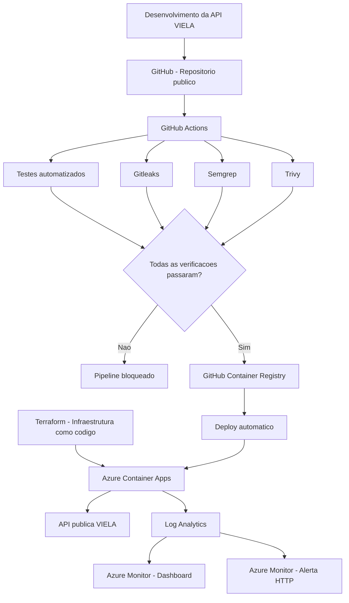

# VIELA — Caminhos que conectam.

### Global Solution FIAP 2026
**Disciplina:** Secure DevOps Tools & Cloud Computing
**Aluna:** Sofia Amorim Coutinho  
**RM:** 552534
**TURMA:** 4ESPX
 
> Mobilidade colaborativa feminina com infraestrutura em nuvem, segurança automatizada e observabilidade.

## 1. Apresentação do projeto

O **VIELA** é uma proposta de mobilidade colaborativa feminina desenvolvida para a Global Solution FIAP 2026.

O projeto parte de um problema cotidiano: mulheres podem enfrentar situações de insegurança durante deslocamentos urbanos, especialmente ao caminhar ou utilizar transporte público em locais com iluminação insuficiente, baixa movimentação ou registros de assédio.

A proposta do VIELA é conectar voluntariamente mulheres com trajetos e horários compatíveis, incentivando deslocamentos acompanhados e o compartilhamento colaborativo de informações relevantes sobre as condições dos espaços urbanos.

O slogan **"Caminhos que conectam."** representa a ideia de transformar trajetos individuais em oportunidades de colaboração e apoio mútuo.

O VIELA não substitui serviços de emergência ou políticas públicas de segurança, nem garante a eliminação dos riscos associados aos deslocamentos.

## 2. Funcionalidades propostas para o VIELA

A visão completa do aplicativo contempla quatro funcionalidades principais.

### 2.1. Match de trajetos

Identificação de mulheres com origens aproximadas, destinos e horários compatíveis, permitindo que avaliem a possibilidade de realizar parte do deslocamento juntas.

### 2.2. Encontro protegido

Conexão voluntária mediante aceitação das participantes, com possibilidade de combinar um ponto público para iniciar o trajeto.

### 2.3. Mapa colaborativo

Registro e consulta de alertas urbanos, como:

- Iluminação insuficiente;
- Baixa movimentação;
- Situações de assédio;
- Problemas de infraestrutura urbana.

### 2.4. Rede de confiança

Mecanismos planejados de verificação, bloqueio, denúncia e compartilhamento voluntário de trajetos com contatos escolhidos.

**Importante:** essas funcionalidades representam a visão do produto. Nem todas estão implementadas no MVP desta disciplina.

## 3. Objetivo desta entrega

Na disciplina **Secure DevOps Tools & Cloud Computing**, o objetivo é demonstrar como uma aplicação relacionada ao VIELA pode ser empacotada, validada, publicada e monitorada utilizando práticas de DevSecOps.

A entrega contempla:

- API REST desenvolvida em Python e FastAPI;
- Imagem Docker com execução sem privilégios de root;
- Ambiente local com Docker Compose;
- Infraestrutura Azure declarada em Terraform;
- Pipeline de integração e entrega contínuas no GitHub Actions;
- Análises automatizadas com Gitleaks, Semgrep e Trivy;
- Publicação da imagem no GitHub Container Registry;
- Deploy automático no Azure Container Apps;
- Monitoramento com Azure Monitor e Log Analytics;
- Dashboard com as quatro métricas de ouro;
- Alerta de erros HTTP efetivamente disparado.

## 4. Ficha Técnica do MVP

| Campo | Descrição |
|---|---|
| Nome | VIELA |
| Slogan | Caminhos que conectam. |
| Contexto | Global Solution FIAP 2026 |
| Área | Mobilidade urbana colaborativa feminina |
| Tipo de entrega | MVP técnico de API REST com pipeline DevSecOps |
| Linguagem | Python 3.11 |
| Framework | FastAPI |
| Servidor | Uvicorn |
| Containerização | Docker e Docker Compose |
| Infraestrutura como código | Terraform |
| Provedor de nuvem | Microsoft Azure |
| Hospedagem | Azure Container Apps |
| Registro de imagens | GitHub Container Registry (GHCR) |
| CI/CD | GitHub Actions |
| Análise de segredos | Gitleaks |
| Análise estática | Semgrep |
| Análise de vulnerabilidades | Trivy |
| Monitoramento | Azure Monitor e Log Analytics |
| Região da aplicação | Canada Central |
| Persistência de dados da API | Memória do processo, sem banco de dados |
| Estado do MVP | Publicado para demonstração |

### Links principais

**Repositório público:**

https://github.com/soficoutinho/VIELA-DevOps

**API publicada:**

https://ca-viela-api.whitebush-e8f6d1dc.canadacentral.azurecontainerapps.io

**Verificação de saúde:**

https://ca-viela-api.whitebush-e8f6d1dc.canadacentral.azurecontainerapps.io/health

**Documentação interativa da API:**

https://ca-viela-api.whitebush-e8f6d1dc.canadacentral.azurecontainerapps.io/docs

**Pipeline GitHub Actions:**

https://github.com/soficoutinho/VIELA-DevOps/actions

## 5. Escopo implementado no MVP

A API implementa um subconjunto das funcionalidades propostas para o VIELA, suficiente para demonstrar o fluxo de desenvolvimento, publicação, segurança e monitoramento.

| Funcionalidade | Situação |
|---|---|
| Consulta de trajetos cadastrados | Implementada |
| Busca de trajetos por origem e destino | Implementada |
| Consulta de alertas urbanos | Implementada |
| Cadastro de alertas urbanos | Implementada |
| Endpoint de saúde da aplicação | Implementado |
| Registro de métricas de requisições | Implementado |
| Autenticação e verificação de usuárias | Não implementadas |
| Encontro protegido entre participantes | Planejado |
| Compartilhamento de trajeto em tempo real | Planejado |
| Mapa geográfico interativo | Planejado |
| Banco de dados persistente | Não implementado |

Os trajetos e alertas iniciais são dados demonstrativos definidos no código.

Os novos alertas cadastrados são armazenados apenas na memória da instância em execução e podem ser perdidos quando a aplicação reinicia ou uma nova revisão é implantada.

O endpoint `/match` realiza uma correspondência simples por igualdade de origem e destino, sem considerar ainda proximidade geográfica, horário ou identidade das participantes.

## 6. Endpoints da API

| Método | Endpoint | Finalidade |
|---|---|---|
| GET | `/` | Identificação e status da aplicação |
| GET | `/health` | Verificação de saúde |
| GET | `/trajetos` | Listagem de trajetos demonstrativos |
| GET | `/alertas` | Consulta de alertas |
| POST | `/alertas` | Cadastro de alerta |
| GET | `/match` | Busca por origem e destino |

### Exemplo de consulta de trajetos

```http
GET /trajetos
```

### Exemplo de busca por compatibilidade

```http
GET /match?origem=Vila%20Mariana&destino=Para%C3%ADso
```

### Exemplo de cadastro de alerta

```json
{
  "local": "Vila Mariana",
  "tipo": "iluminacao",
  "descricao": "Trecho com iluminacao insuficiente."
}
```

O cadastro é demonstrativo e não exige autenticação. Por isso, a API não deve ser utilizada como plataforma de produção com dados pessoais reais.

## 7. Estrutura do repositório

```text
VIELA-DevOps/
├── .github/
│   └── workflows/
│       └── devsecops.yml
├── backend/
│   ├── main.py
│   └── test_main.py
├── monitoring/
│   └── evidencias/
├── terraform/
│   ├── main.tf
│   └── .terraform.lock.hcl
├── .dockerignore
├── .gitignore
├── Dockerfile
├── compose.yaml
├── requirements.txt
├── requirements-dev.txt
└── README.md
```

## 8. Execução local com Docker Compose

### Pré-requisitos

- Git;
- Docker Engine ou Docker Desktop;
- Docker Compose.

Clone o repositório:

```bash
git clone https://github.com/soficoutinho/VIELA-DevOps.git
cd VIELA-DevOps
```

Construa e inicie a aplicação:

```bash
docker compose up --build -d
```

Acesse:

http://localhost:8000/health

Documentação interativa:

http://localhost:8000/docs

Verifique os containers:

```bash
docker compose ps
```

Visualize os logs:

```bash
docker compose logs -f
```

Encerre o ambiente:

```bash
docker compose down
```

O Docker Compose publica a porta 8000 somente no endereço local `127.0.0.1`, evitando sua exposição direta na rede externa durante os testes locais.

## 9. Segurança do container

O Dockerfile utiliza `python:3.11-slim` para reduzir a superfície da imagem.

Entre as medidas adotadas estão:

- Execução com usuário dedicado `viela`, sem privilégios de root;
- Atualização de pacotes do sistema durante a construção;
- Atualização de dependências Python relacionadas à segurança;
- Instalação de dependências sem cache do pip;
- Ausência de credenciais embutidas no Dockerfile;
- Endpoint `/health` utilizado pelo healthcheck;
- Separação entre código da aplicação e configurações de infraestrutura.

No Docker Compose também são aplicadas medidas adicionais:

- `no-new-privileges:true`;
- Remoção das capacidades Linux com `cap_drop: ALL`;
- Sistema de arquivos somente leitura;
- Diretório temporário em memória;
- Publicação de porta limitada ao localhost.

Essas medidas reduzem riscos, mas não substituem análises contínuas, atualização de dependências e controles de acesso.

## 10. Testes automatizados

Os testes estão no arquivo:

`backend/test_main.py`

Para executar localmente com Python 3.11:

```bash
python -m pip install -r requirements-dev.txt
python -m pytest backend/test_main.py -v
```

Os testes também são executados automaticamente no GitHub Actions.

## 11. Infraestrutura como código — Terraform

O arquivo `terraform/main.tf` declara os principais componentes da infraestrutura:

- Grupo de recursos Azure existente, consultado como fonte de dados;
- Workspace Log Analytics existente, consultado como fonte de dados;
- Azure Container Apps Environment;
- Azure Container App com acesso HTTP público;
- Configuração de CPU, memória e escalonamento;
- Healthcheck da aplicação;
- Associação do ambiente ao Log Analytics.

O ambiente e a aplicação são gerenciados pelo Terraform. O grupo de recursos e o workspace de monitoramento foram criados previamente e são referenciados pelo código.

### Pré-requisitos

- Terraform instalado;
- Azure CLI instalado;
- Permissões adequadas na assinatura Azure.

Autentique-se:

```bash
az login
```

Acesse a pasta:

```bash
cd terraform
```

Inicialize:

```bash
terraform init
```

Valide:

```bash
terraform validate
```

Examine as alterações propostas:

```bash
terraform plan
```

**Atenção:** não execute `terraform apply` sem revisar o plano.

A aplicação publicada também é atualizada pelo GitHub Actions. Por esse motivo, podem existir diferenças entre a imagem ou determinadas configurações operacionais no Azure e os valores declarados no Terraform.

Um `terraform plan` pode propor alterações mesmo quando a API está funcionando corretamente. Essas alterações devem ser avaliadas antes de qualquer aplicação para evitar interferências no deploy e no monitoramento.

### Proteção de arquivos sensíveis

O `.gitignore` exclui arquivos de estado do Terraform, arquivos `.tfvars` e outros artefatos locais que não devem ser publicados no repositório.

O arquivo `.terraform.lock.hcl` é mantido para registrar a seleção de dependências do provedor.

## 12. Pipeline DevSecOps

O workflow está definido em:

`.github/workflows/devsecops.yml`

Ele é acionado por:

- Push;
- Pull request;
- Execução manual.

### Etapas de validação

**Testes automatizados:** executam os testes da API.

**Gitleaks:** procura possíveis segredos expostos no repositório e no histórico analisado.

**Semgrep:** executa análise estática do código com regras automáticas.

**Trivy:** constrói a imagem Docker e procura vulnerabilidades HIGH e CRITICAL com correção disponível, bloqueando a execução quando encontra ocorrências abrangidas por essa política.

### Publicação e deploy

Em pushes na branch `main`, a publicação no GHCR depende da aprovação dos quatro jobs anteriores.

Somente após a publicação bem-sucedida ocorre o deploy automático no Azure Container Apps.

O workflow utiliza credenciais Azure referenciadas por GitHub Secrets e autenticação federada OIDC, sem armazenar uma senha de acesso ao Azure no código.

Após o deploy, o pipeline verifica a disponibilidade do endpoint `/health`.

### Evidências do bloqueio de segurança

O projeto documenta uma execução em que o Trivy bloqueou a continuidade do pipeline e uma execução posterior bem-sucedida após a correção.

Execução bloqueada:

https://github.com/soficoutinho/VIELA-DevOps/actions/runs/43591178948

Execução bem-sucedida:

https://github.com/soficoutinho/VIELA-DevOps/actions/runs/43608773299

As capturas de tela estão disponíveis na pasta `monitoring/evidencias/`.

## 13. Arquitetura da solução



O diagrama representa o fluxo de desenvolvimento, validação, publicação, infraestrutura e observabilidade.

## 14. Observabilidade — Quatro métricas de ouro

O monitoramento foi implementado com Azure Monitor, Log Analytics e um Workbook de visualização.

### 14.1. Latência

A API registra a duração das requisições em milissegundos por meio de um middleware FastAPI.

### 14.2. Tráfego

Acompanha o volume de requisições recebidas pela aplicação.

### 14.3. Erros

Permite identificar respostas HTTP de erro, incluindo requisições que retornam status 404.

### 14.4. Saturação

Utiliza indicadores de consumo de recursos, incluindo CPU do ambiente de execução.

### Alerta disparado

Foi configurada uma regra de alerta no Azure Monitor:

`VIELA-Alertas-Erros-HTTP`

A regra foi testada mediante a geração controlada de requisições HTTP com erro. O histórico do Azure Monitor registrou disparos do alerta.

As evidências visuais do dashboard e dos alertas estão disponíveis em `monitoring/evidencias/`.

## 15. Responsabilidade compartilhada na nuvem

A segurança da solução segue o modelo de responsabilidade compartilhada.

### Responsabilidades da Microsoft Azure

- Segurança física dos datacenters;
- Infraestrutura física e de virtualização subjacente;
- Operação dos serviços gerenciados conforme o modelo de serviço contratado;
- Controles de segurança disponibilizados pela plataforma.

### Responsabilidades da equipe VIELA

- Segurança do código da aplicação;
- Atualização de dependências e imagens;
- Configuração do container e dos serviços;
- Controle de identidades e permissões;
- Proteção de credenciais;
- Análise de vulnerabilidades;
- Monitoramento de erros e comportamento;
- Tratamento adequado de dados pessoais;
- Revisão de alterações de infraestrutura.

A utilização de serviços gerenciados não elimina a responsabilidade da equipe sobre a segurança da aplicação e de suas configurações.

## 16. Privacidade, localização dos dados e LGPD

O VIELA foi concebido para um contexto sensível: a mobilidade e a segurança de mulheres em ambientes urbanos.

Uma futura versão completa poderá tratar dados pessoais, como identidade, horários, locais de origem e destino, contatos de confiança e informações de deslocamento.

Esses dados exigirão medidas de proteção proporcionais aos riscos, incluindo minimização, controle de acesso, transparência, retenção limitada e mecanismos adequados de atendimento aos direitos das titulares.

### Situação do MVP atual

A API desta disciplina utiliza dados demonstrativos de trajetos e alertas.

Não existe banco de dados persistente integrado ao backend. Os dados iniciais estão definidos no código, e os alertas criados durante a execução permanecem apenas na memória do processo.

A API registra metadados técnicos das requisições, incluindo método HTTP, rota, código de resposta e duração.

O código apresentado não implementa autenticação, gestão de consentimento ou controles completos de privacidade necessários para operação com usuárias reais.

### Localização na nuvem

A aplicação está hospedada na região **Canada Central**, no Microsoft Azure.

O ambiente utiliza um workspace Log Analytics para armazenar e consultar registros de monitoramento.

A localização da infraestrutura fora do Brasil exige atenção às regras aplicáveis às transferências internacionais de dados pessoais, caso o projeto evolua para o tratamento de informações reais de usuárias.

A versão demonstrativa não deve receber dados pessoais reais ou relatos sensíveis identificáveis.

## 17. Estimativa de custos

A infraestrutura foi dimensionada para um MVP acadêmico de baixo tráfego.

### Componentes considerados

| Serviço | Configuração de referência |
|---|---|
| Azure Container Apps | Plano Consumption |
| CPU | 0,25 vCPU |
| Memória | 0,5 GiB |
| Réplicas | Mínimo 0, máximo 1 |
| Log Analytics | Retenção configurada de 30 dias |
| Azure Monitor | Dashboard e regra de alerta |
| GitHub Actions | Execuções do pipeline |
| GHCR | Armazenamento da imagem Docker |

O custo efetivo depende do volume de requisições, do tempo de execução do container, da ingestão de logs, das consultas, dos alertas e dos limites gratuitos aplicáveis.

A estimativa monetária detalhada e suas premissas serão apresentadas no relatório PDF final, utilizando os preços aplicáveis à assinatura e à região da infraestrutura.

O uso de créditos educacionais pode reduzir o desembolso, mas não elimina a necessidade de acompanhar o consumo.

## 18. Evidências de implementação

As capturas de tela estão organizadas em:

`monitoring/evidencias/`

Elas documentam:

- Pipeline completo executado com sucesso;
- Testes automatizados;
- Análises Gitleaks e Semgrep;
- Verificação Trivy;
- Bloqueio de segurança e correção;
- Publicação no GHCR;
- Deploy no Azure;
- Dashboard de tráfego;
- Dashboard de latência;
- Dashboard de erros;
- Dashboard de CPU;
- Consulta de logs HTTP;
- Alerta efetivamente disparado.

## 19. Limitações e evolução futura

O MVP foi desenvolvido para demonstrar a arquitetura e o processo DevSecOps, não para disponibilizar o aplicativo completo a usuárias finais.

Evoluções planejadas incluem:

- Autenticação e verificação de usuárias;
- Banco de dados persistente;
- Correspondência de trajetos com critérios geográficos e temporais;
- Fluxo de aceitação para encontros protegidos;
- Mapa interativo;
- Denúncias, bloqueios e mecanismos de confiança;
- Políticas completas de privacidade e proteção de dados;
- Controles adicionais de segurança, disponibilidade e escalabilidade.

## 20. Conclusão

O VIELA combina uma proposta de impacto social com uma demonstração prática de engenharia de software segura.

Nesta entrega, a API foi containerizada, submetida a verificações automatizadas de qualidade e segurança, publicada no Azure por um pipeline DevSecOps e integrada a ferramentas de monitoramento.

O projeto demonstra como práticas de infraestrutura como código, integração contínua, entrega automatizada e observabilidade podem apoiar a evolução de uma solução de mobilidade colaborativa feminina.

**VIELA — Caminhos que conectam.**
